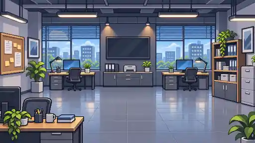
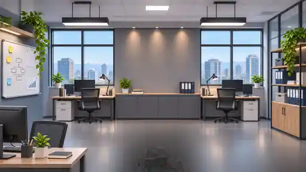
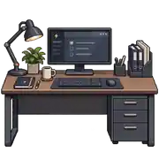
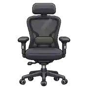
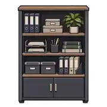
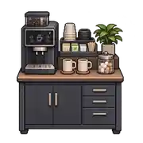
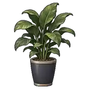
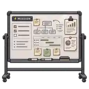

# Biblioteca de oficina · SparkFlow

Recursos gráficos separados para diseñar una oficina seria con estética pixel-art, sin colores neón predominantes. Los archivos **no se cargan automáticamente en el juego**: esta carpeta es un catálogo para escoger y componer la próxima interfaz sin modificar la lógica.

## Personajes
| Recurso | Uso |
|---|---|
|  | Personaje que presenta misiones |
|  | Cuadro de diálogo de misión |
|  | Personaje jugador / oficina |
|  | Perfil e instrucciones |

## Fondos
| Vista | Recurso |
|---|---|
| Oficina pixel-art diurna |  |
| Oficina corporativa neutra |  |

## Mobiliario reutilizable
| Escritorio | Silla | Archivador |
|---|---|---|
|  |  |  |

| Cafetera | Planta | Pizarra |
|---|---|---|
|  |  |  |

## Integración recomendada
- Mantener la zona central del SVG de circuitos y rutas por encima de cualquier fondo.
- Usar los retratos pequeños junto al objetivo y los personajes de pie como decoración lateral.
- No modificar los IDs del juego, el sistema de 13 misiones, las reglas de los routers ni el progreso.
- Los sprites PNG tienen transparencia; los fondos y objetos se entregan en WebP para reducir peso.

**Fecha del catálogo:** 2026-11-12.
